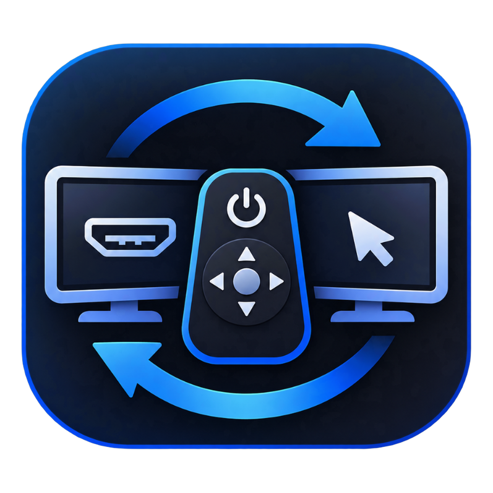

<p align="center">
  
</p>

<h1 align="center">CecDesk</h1>

<p align="center">
  Программно-аппаратный мост между пультом ДУ телевизора (HDMI-CEC) и ПК / SteamOS (Steam Deck)
</p>

<p align="center">
  <a href="https://github.com/mitrafun-creator/CecDesk/releases/tag/v1.1.0-beta.1"></a>
  <a href="LICENSE"></a>
  
</p>

<p align="center">
  <a href="https://github.com/mitrafun-creator/CecDesk/releases">Скачать релиз</a> •
  <a href="#быстрый-старт">Быстрый старт</a> •
  <a href="CHANGELOG.md">Changelog</a> •
  <a href="docs/BETA_TESTING.md">Бета-тестирование</a>
</p>

> **Программно-аппаратный комплекс:** `CecDesk`  
> **Десктопное ПО:** `CecDesk App` (Tauri v2 + Rust Backend + Vanilla ES6 WebUI)  
> **Аппаратный модуль:** `CecDesk Dongle` (Plug-and-Play USB-адаптер HDMI-CEC; схемотехника и прошивка распространяются отдельно)  
> **Поддерживаемые ТВ:** Универсальный профиль HDMI-CEC 1.4/2.0, Philips EasyLink, LG SimpLink, Samsung Anynet+, Sony BRAVIA Sync, Panasonic VIERA Link, TCL, Hisense VIDAA, Xiaomi, Toshiba, Sharp

---

## Возможности проекта

1. **Интеграция с телевизором по HDMI-CEC (`CecDesk Dongle` + EDID)**:
   - Автоматически определяет физический адрес HDMI-порта и производителя ТВ из EDID (Windows Registry / DRM EDID в Linux).
   - Регистрирует устройство в меню источников телевизора.
   - Синхронизированное управление питанием ТВ («Включить ТВ» / «Выключить ТВ») с контролем реального состояния экрана по протоколу CEC (`0x90` / `0x36`).

2. **Динамический конструктор пульта и режим калибровки**:
   - Конструктор интерфейса автоматически собирает раскладку пульта из доступных клавиш и профилей.
   - Интерактивный режим обучения (калибровка): пользователь нажимает кнопки на физическом пульте, система перехватывает команды и формирует персональную таблицу маппинга.
   - Защита во время обучения: эмуляция системных действий ОС автоматически блокируется.

3. **Управление Windows и Linux / SteamOS с пульта ДУ**:
   - Перехват кнопок пульта и трансляция в действия ОС / игр (включая Gamescope & Desktop Mode в SteamOS).
   - При отключении перехвата пульт мгновенно возвращается в штатный режим управления меню телевизора.
   - **Режим мыши с прогрессивным разгоном**:
     - Управление курсором стрелками пульта (точный микро-шаг и плавный разгон при удержании).
     - Быстрые прыжки по 9 секторам экрана с цифровых клавиш, ЛКМ / ПКМ / двойной клик.
     - Автоматический возврат в обычный режим через 40 секунд неактивности.
   - **Умная перемотка (Hold-to-Accelerate Seek)**: одиночное нажатие — шаг 5 сек, удержание — ускорение до 15–30 сек.
   - **Экранная клавиатура (OSK) и HUD Overlay**: полупрозрачные OSD-уведомления и 2D-навигация по виртуальной клавиатуре без потери фокуса полноэкранных игр.
   - **Аварийное закрытие зависших задач**: опциональное завершение зависшего полноэкранного процесса по долгому удержанию кнопки «Назад».

4. **Пользовательские сценарии (`scripts/`)**:
   - Запуск `.bat`, `.cmd`, `.ps1`, `.vbs` (Windows) и `.sh` / исполняемых скриптов (Linux / SteamOS) по нажатию любой кнопки пульта.

5. **Диагностика, профили и обновления**:
   - Встроенный каталог профилей телевизоров (`tv_profiles/`) с онлайн-синхронизацией.
   - Генератор диагностического архива `cecdesk_support_<timestamp>.zip` с автоматическим маскированием локальных путей и токенов (Zero-PII).
   - Самообновление Windows в 1 клик через GitHub Releases с проверкой SHA-256, ZIP CRC-32 и PE-заголовка.

---

## Структура репозитория

```text
CecDesk/
├── LICENSE                         <-- Лицензия PolyForm Noncommercial License 1.0.0
├── THIRD_PARTY_NOTICES.md          <-- Сторонние компоненты и лицензии
├── CHANGELOG.md                    <-- История версий и патч-ноуты (Keep a Changelog)
├── AGENTS.md                       <-- Правила процесса разработки
├── version.json                    <-- Манифест актуальной версии, ссылок и SHA-256
├── build_release.bat               <-- Сборка релиза Windows + упаковка .zip + обновление SHA-256
├── release_tool.bat                <-- CLI-пайплайн версий и патч-ноутов (check / bump / notes / gate)
├── install_steamos.sh              <-- Автоустановщик для SteamOS (Steam Deck) / Linux
├── cecdesk_config.default.json     <-- Базовый шаблон конфигурации (universal_hdmi_cec)
│
├── bin/                            <-- Вспомогательные системные утилиты (AudioTool.exe для WASAPI)
├── tauri_app/                      <-- Исходный код десктопного приложения
│   ├── src-tauri/                  <-- Модульный Rust-бэкенд (Tauri v2, EDID, CEC, OSK, HUD, Updater, Telemetry)
│   └── ui/                         <-- Графический интерфейс (Vanilla ES6, Dark Glassmorphism)
│
├── tv_profiles/                    <-- База профилей телевизоров (JSON + catalog.json)
├── scripts/                        <-- Каталог пользовательских скриптов и scripts/README.md
├── scripts_dev/                    <-- Скрипты сборочного пайплайна и контроля версий
├── pm/                             <-- Локальный трекер задач и шаблоны
└── docs/                           <-- Документация ПО
    ├── BETA_TESTING.md             <-- Чеклист бета-тестера и правила отправки отчётов
    ├── PROCESS_AND_ROLES.md        <-- Процесс разработки и роли
    ├── RELEASE_AND_VERSIONING.md   <-- Контроль версий и пайплайн патч-ноутов
    ├── TELEMETRY_AND_REPORTS.md    <-- Контракт диагностического .zip, маскирование и privacy
    └── UNIVERSAL_API_SPEC.md       <-- Спецификация протокола CBP v1.0
```

---

## Быстрый старт

### 1. Установка и запуск на Windows 10 / 11 (x64)
1. Скачайте архив **`CecDesk_Windows_x64.zip`** со страницы [Releases](https://github.com/mitrafun-creator/CecDesk/releases).
2. Распакуйте архив целиком в **папку с правами записи текущего пользователя** — например, `C:\Tools\CecDesk\` или `Documents\CecDesk\`.
   > Важно: не извлекайте только один `.exe` без `WebView2Loader.dll`, `tv_profiles/` и `bin/`. Не рекомендуется размещать программу в `C:\Program Files`, чтобы автообновление в 1 клик могло обновлять файлы без запроса прав администратора.
3. Подключите адаптер `CecDesk Dongle` и запустите `CecDesk.exe`.
   - Если появится предупреждение **Windows Defender SmartScreen**: так как бета-сборки ещё не подписаны коммерческим EV-сертификатом, нажмите **«Подробнее» -> «Выполнить в любом случае»**. Обновления с GitHub проверяются по SHA-256, целостности ZIP CRC-32 и заголовку PE.
4. *(По желанию)* Для портативного режима (хранение конфигурации, скриптов и логов рядом с `.exe` вместо `%LOCALAPPDATA%\CecDesk\`) создайте пустой файл `portable.txt` рядом с `CecDesk.exe` или запускайте с флагом `--portable`.

### 2. Установка на SteamOS (Steam Deck) / Linux
Выполните команду в терминале (Konsole в Desktop Mode или по SSH):
```bash
curl -fsSL https://raw.githubusercontent.com/mitrafun-creator/CecDesk/main/install_steamos.sh | bash
```
Или через клонирование репозитория:
```bash
git clone https://github.com/mitrafun-creator/CecDesk.git && cd CecDesk && chmod +x install_steamos.sh && ./install_steamos.sh
```
Установщик скачает готовый бинарник (или соберёт приложение из исходников через Rust/Cargo), настроит правила `udev` (USB Serial и виртуальный ввод `uinput` для Gamescope), создаст ярлык и запустит фоновый пользовательский сервис `systemd` (`cecdesk.service`).

### 3. Сборка из исходников (Windows)
При наличии настроенного окружения Rust/MinGW запустите из корня репозитория:
```cmd
build_release.bat
```
Скрипт скомпилирует релизный бинарник Rust, обновит `CecDesk.exe` и `WebView2Loader.dll`, пересоберёт `CecDesk_Windows_x64.zip` и синхронизирует хэш `windows_sha256` в `version.json`.

---

## Матрица совместимости (бета-статус)

### Платформы

| Компонент | Статус в бета-версии | Примечания |
| --- | --- | --- |
| Windows 10 / 11 (x64) | Основная целевая сборка | Доступна в [`CecDesk_Windows_x64.zip`](https://github.com/mitrafun-creator/CecDesk/releases) (требует WebView2 Runtime, по умолчанию есть в Windows 11 / актуальной Windows 10) |
| SteamOS / Linux (x64) | Сборка из исходников | Готовый бинарник в Releases ещё не опубликован; [`install_steamos.sh`](install_steamos.sh) собирает проект локально через `cargo` |

### Профили телевизоров (`tv_profiles/`)

| Профиль / Бренд | Файл | Статус проверки |
| --- | --- | --- |
| Philips 32PFL9705H (EasyLink) | `philips_32pfl9705h.json` | Проверен на реальном ТВ в ходе разработки |
| Samsung UE43J5272 (Anynet+ / Orsay) | `samsung_ue43j5272.json` | Профиль для тестирования на серии J (2015) |
| Универсальный HDMI-CEC 1.4/2.0 | `universal_hdmi_cec.json` | Базовый шаблон по умолчанию |
| Philips Ambilight (Android / Google TV) | `philips_ambilight_android.json` | По спецификации CEC, ожидает тестов сообщества |
| LG SimpLink (webOS) | `lg_simplink_webos.json` | По спецификации CEC, ожидает тестов сообщества |
| Samsung Anynet+ (Tizen OS) | `samsung_anynet_tizen.json` | По спецификации CEC, ожидает тестов сообщества |
| Sony BRAVIA Sync (Google TV) | `sony_bravia_sync.json` | По спецификации CEC, ожидает тестов сообщества |
| Panasonic VIERA Link | `panasonic_viera_link.json` | По спецификации CEC, ожидает тестов сообщества |
| Hisense VIDAA Smart TV | `hisense_vidaa_cec.json` | По спецификации CEC, ожидает тестов сообщества |
| TCL Mini-LED / QLED (T-Link) | `tcl_google_tv.json` | По спецификации CEC, ожидает тестов сообщества |
| Toshiba REGZA (CE-Link) | `toshiba_regza_link.json` | По спецификации CEC, ожидает тестов сообщества |
| Sharp AQUOS Link | `sharp_aquos_link.json` | По спецификации CEC, ожидает тестов сообщества |
| Xiaomi TV / PatchWall | `xiaomi_mi_tv.json` | По спецификации CEC, ожидает тестов сообщества |

---

## Тестирование бета-версии и отчёты об ошибках

Подробный чеклист проверки для участников тестирования находится в [`docs/BETA_TESTING.md`](docs/BETA_TESTING.md).

Если во время тестирования возникла ошибка, интерфейс закрылся некорректно или телевизор/пульт ведёт себя неожиданно:
1. Откройте **Настройки -> Диагностика, отчёты и телеметрия** (или нажмите «Создать отчёт (.zip)» на баннере восстановления после сбоя).
2. Нажмите **«Создать отчёт (.zip)»** — приложение сформирует локальный архив `cecdesk_support_<timestamp>.zip` в папке `reports/`.
   - Персональные пути (`C:\Users\<USER>\...`, `/home/<USER>/...`) и токены автоматически заменяются на маски перед сохранением архива (подробнее: [`docs/TELEMETRY_AND_REPORTS.md`](docs/TELEMETRY_AND_REPORTS.md)).
3. Опишите шаги воспроизведения и приложите созданный `.zip` в [GitHub Issues](https://github.com/mitrafun-creator/CecDesk/issues).

*(Опциональная анонимная телеметрия по умолчанию выключена и срабатывает только при явном согласии пользователя и указании собственного HTTPS Webhook-приёмника.)*

---

## Лицензия

Программная часть **CecDesk** (`CecDesk App`, профили `tv_profiles/`, скрипты и документация) распространяется под лицензией **PolyForm Noncommercial License 1.0.0** ([`LICENSE`](LICENSE)): разрешено некоммерческое использование, изучение и модификация; коммерческое использование, продажа и выпуск коммерческих продуктов на основе проекта или его форков запрещены. Полный перечень лицензий сторонних компонентов приведён в [`THIRD_PARTY_NOTICES.md`](THIRD_PARTY_NOTICES.md).
