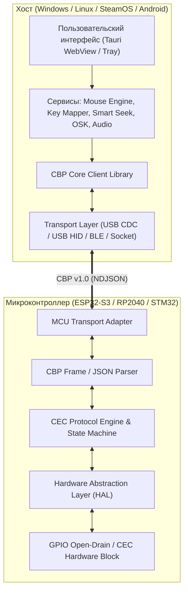

# Спецификация универсального API контроллера: CEC Bridge Protocol (CBP v1.0)

> **Статус:** Черновик архитектуры (v1.0-draft)  
> **Автор проекта:** Dimitryi Garutt  
> **Идентификатор устройства:** `CecDesk Dongle dev/r.1`

---

## 1. Концепция и цели архитектуры

Исторически взаимодействие микроконтроллера и десктопного ПО строилось на текстовых эхо-командах (`REMOTE_ON`, `STATE`, сырой вывод `RX 04: 44 01`). Это создавало сильную связанность (tight coupling): софт парсил произвольные строки, а микроконтроллер смешивал логику шины CEC и бизнес-логику ОС.

**Цель CBP v1.0:** Превратить микроконтроллер в **прозрачный аппаратный шлюз (Hardware Abstraction Layer)**.  
Вся бизнес-логика (маппинг клавиш, эмуляция мыши, умная перемотка, экранная клавиатура, переключение аудио) живет исключительно на хосте. Контроллер отвечает только за:
1. Физический уровень CEC (тайминги, Open-Drain, подтяжка, арбитраж, ACK/NACK).
2. Поддержание логических адресов (Playback Device, Audio System и т.д.).
3. Обмен структурированными сообщениями с хостом по универсальному протоколу.

---

## 2. Уровни абстракции



---

## 3. Транспортный уровень и форматирование

### 3.1 Формат фреймов
Протокол использует **NDJSON (Newline-Delimited JSON)**:
- Каждое сообщение представляет собой валидный JSON-объект.
- Сообщение завершается символом перевода строки `\n` (`0x0A`).
- Кодировка символов: строго **UTF-8**.
- Длина одного пакета не превышает 256 байт (помещается в буфер любого микроконтроллера с 2 КБ RAM).

### 3.2 Поддерживаемые транспорты
1. **USB CDC (Virtual COM-порт)** — стандартный режим (115200 бод, 8N1).
2. **USB HID (Custom Vendor Report)** — Plug & Play без виртуальных портов и без драйверов.
3. **Bluetooth LE (Nordic UART Service)** — беспроводной вариант для пультов и приставок.
4. **TCP/IP Socket / WebSocket** — управление по локальной сети через встроенный Wi-Fi ESP32.
5. **Linux V4L2 CEC (`/dev/cec0`)** — виртуальный драйвер хоста без внешнего контроллера.

---

## 4. Спецификация сообщений протокола

Все сообщения содержат обязательное поле типа:
- `"cmd"` — запрос от хоста к контроллеру.
- `"res"` — синхронный ответ контроллера на команду хоста.
- `"evt"` — асинхронное событие от контроллера к хосту (прием пакета с ТВ, смена линии, HPD).

---

### 4.1 Рукопожатие и согласование возможностей (Handshake)

#### Запрос хоста:
```json
{
  "cmd": "hello",
  "client": "CecDesk",
  "proto_ver": 1
}
```

#### Ответ контроллера:
```json
{
  "res": "hello",
  "status": "ok",
  "device": "CecDesk Dongle dev/r.1",
  "manufacturer": "Dimitryi Garutt",
  "mcu": "ESP32-S3",
  "fw_ver": "2.0.0",
  "capabilities": [
    "CEC_PROMISCUOUS",
    "EDID_SNIFFER",
    "LINE_SENSE",
    "AUTO_PING"
  ],
  "cec_state": {
    "logical_addr": 4,
    "physical_addr": "3000",
    "osd_name": "GAMING PC",
    "capture_mode": "passthrough"
  }
}
```

---

### 4.2 Управление перехватом пульта (Capture Mode)

Хост может на лету переключать режим обработки команд пульта телевизором и ПК:

```json
{
  "cmd": "set_capture",
  "mode": "passthrough"
}
```

Допустимые режимы `"mode"`:
| Режим | Поведение контроллера | Применение |
| :--- | :--- | :--- |
| `passthrough` | Контроллер подтверждает прием (`ACK`) и передает все нажатия кнопок хосту (`cec_rx`). Телевизор не обрабатывает кнопки у себя. | Активное управление ПК (игры, браузер, видео). |
| `tv_local` | Контроллер отвечает `Feature Abort` (`0x00 0x44 0x01`) и отправляет `Menu Inactive`. Телевизор забирает кнопки себе. Имя разъема "GAMING PC" на ТВ сохраняется. | Пользователь настраивает звук, картинку или каналы на самом телевизоре. |
| `monitor_only` | Контроллер только слушает шину (Promiscuous mode), не отвечая ACK на чужие пакеты. | Анализ шины, дебаг, диагностика чужих приставок. |

#### Ответ:
```json
{
  "res": "set_capture",
  "status": "ok",
  "mode": "passthrough"
}
```

---

### 4.3 События шины CEC (Events: Контроллер -> Хост)

#### Прием пакета (User Control Pressed / Опрос ТВ / Питание):
```json
{
  "evt": "cec_rx",
  "src": 0,
  "dst": 4,
  "opcode": "0x44",
  "params": ["0x01"],
  "ack": true,
  "ts_ms": 142580
}
```
*Пояснение полей:*
- `src`: логический адрес отправителя (0 = TV).
- `dst`: логический адрес получателя (4 = Playback 1, 15 = Broadcast).
- `opcode`: HEX-строка опкода CEC (`0x44` = User Control Pressed).
- `params`: массив HEX-байт параметров (код кнопки `0x01` = Вверх).
- `ack`: подтвержден ли пакет контроллером.

#### Отпускание кнопки (0x45 User Control Released):
```json
{
  "evt": "cec_rx",
  "src": 0,
  "dst": 4,
  "opcode": "0x45",
  "params": [],
  "ack": true
}
```

#### Изменение физического состояния линии CEC (Диагностика):
```json
{
  "evt": "line_state",
  "pullup_detected": true,
  "voltage_ok": true
}
```

---

### 4.4 Отправка пакетов в шину CEC (Commands: Хост -> Контроллер)

Хост может отправить любой фрейм на любое устройство шины:

```json
{
  "cmd": "cec_tx",
  "dst": 0,
  "opcode": "0x82",
  "params": ["0x30", "0x00"]
}
```
*(Пример: объявить себя активным источником Active Source для порта HDMI 3)*.

#### Ответ контроллера:
```json
{
  "res": "cec_tx",
  "status": "ok",
  "tx_ack": true,
  "retries": 0
}
```
Если устройство на шине не ответило (NACK):
```json
{
  "res": "cec_tx",
  "status": "nack",
  "retries": 3
}
```

---

### 4.5 Конфигурация идентификации устройства (OSD Name & PA)

```json
{
  "cmd": "set_device_info",
  "osd_name": "GAMING PC",
  "physical_addr": "3000",
  "logical_addr": 4
}
```

Контроллер сохраняет эти параметры в оперативной памяти (или NVS/EEPROM) и автоматически отвечает ими на стандартные запросы ТВ:
- `0x83` (Give Physical Address) -> ответ `0x84 [PA_HIGH] [PA_LOW] [DEVICE_TYPE]`
- `0x46` (Give OSD Name) -> ответ `0x47 [ASCII...]`
- `0x8C` (Give Device Vendor ID) -> ответ `0x87 00 0C 03`

---

## 5. Аппаратный уровень абстракции (HAL) на микроконтроллере

Для поддержки разных чипов архитектура прошивки делится на 3 независимых модуля:

```
firmware/
├── include/
│   ├── cbp_protocol.h        <-- Парсер и сериализатор NDJSON (независим от железа)
│   ├── cec_hal.h             <-- Интерфейс управления пином CEC (read, write, timer)
│   └── transport_hal.h       <-- Интерфейс связи с ПК (USB CDC / UART / HID)
└── src/
    ├── targets/
    │   ├── esp32s3/          <-- Реализация под ESP32-S3 (RMT / GPIO4 / HWCDC)
    │   ├── rp2040/           <-- Реализация под Raspberry Pi Pico (PIO state machine)
    │   └── stm32/            <-- Реализация под STM32F042 (Hardware CEC периферия)
    └── main.cpp              <-- Главный цикл диспетчеризации CBP
```

### Преимущества такой модульности:
1. **Никакого хардкода**: пины, номера таймеров и способы чтения Serial изолированы в таргетах.
2. **Переносимость**: чтобы запустить эмулятор на Raspberry Pi Pico, достаточно реализовать интерфейс `cec_hal.h` через 4 инструкции PIO.
3. **Тестируемость**: CBP протокол можно тестировать unit-тестами на ПК без физического подключения платы к ТВ.

---

## 6. Идентификация устройства в ОС

Устройство идентифицируется как:
- **Product Name:** `CecDesk Dongle dev/r.1 by Dimitryi Garutt`
- **Manufacturer:** `Dimitryi Garutt`
- **USB VID / PID:** `0x303A:0x1001` (Espressif USB Composite)
- **Serial Number:** `CECDESK-001`

ПО автоматически обнаруживает устройство по VID/PID и строке дескриптора, исключая необходимость ручного выбора COM-порта пользователем.
